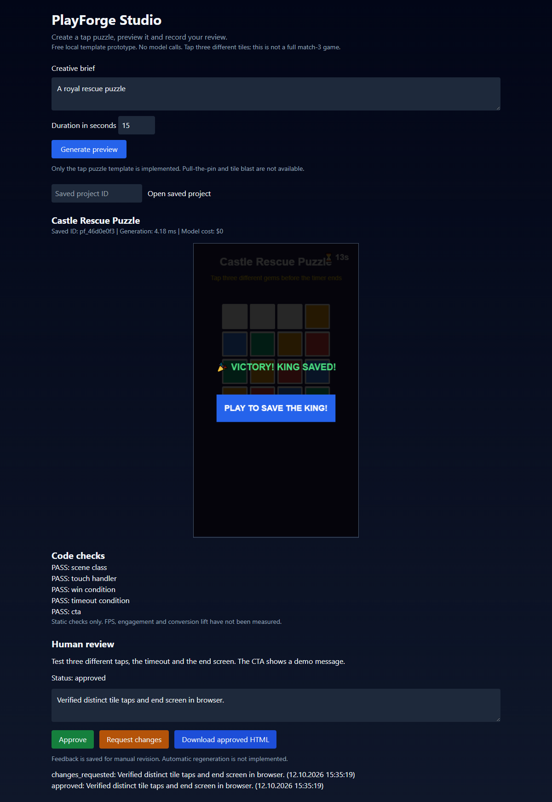
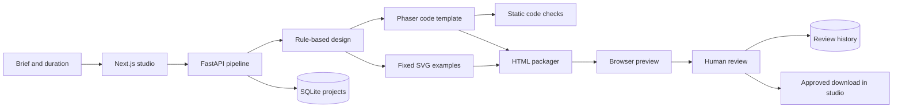

# PlayForge AI

**A local studio for building, previewing and reviewing HTML5 playable ad prototypes.**

PlayForge turns a brief into a template-based tap puzzle, packages it as an offline HTML file, and records a human review before enabling download in the studio. It brings Python pipeline development, interactive creative output and review tooling together in one inspectable project.

The current version runs without paid APIs. Generation uses deterministic Python stages and Phaser templates; LLM orchestration and image/video model integration are planned extensions.



## What you can try

1. Enter a brief and choose a duration between 5 and 60 seconds.
2. Generate and play a tap puzzle in the browser.
3. Inspect the static code checks and measured pipeline duration.
4. Approve the output or request changes with written feedback.
5. Download the approved HTML and open it without internet access.
6. Restore a saved project by ID to inspect its review history.

The implemented mechanic requires three different tile taps to win. Repeated taps on the same tile do not earn extra points. Letting the timer expire produces a failure screen.

## Engineering focus

| Area | Implemented evidence |
| --- | --- |
| Python creative pipeline | FastAPI endpoint, Pydantic request/response models and separate design, code, asset and validation stages |
| Playable creative output | Phaser scene template, touch interaction, timer, win/fail screens and demo CTA |
| Evaluation | Explicit static checks for scene structure, touch handlers, win logic, timeout and CTA; separate browser regression checks |
| Human-in-the-loop review | Persistent approve/request-changes decisions with feedback and timestamps |
| Reproducibility | Local setup, backend tests and a versioned Phaser engine bundled into exported HTML |

This project focuses on tooling around creative production: inspectable outputs, explicit failure states and recorded human decisions. It is a portfolio prototype, with the boundary between implemented and proposed features documented below.

## Architecture



The classes named `Agent` are currently deterministic processing modules. They do not invoke an LLM or use function calling. The optimization stage returns no performance claims or simulated improvements.

## Stack

Python, FastAPI, Pydantic, SQLite, Next.js, React, TypeScript, Tailwind CSS and Phaser 3.80.1.

## Run locally

Prerequisites: Python 3.11+ and Node.js 18.17+.

```powershell
git clone https://github.com/themaden/PlayForge-AI.git
cd PlayForge-AI
python -m venv .venv
.venv\Scripts\python.exe -m pip install -r backend/requirements.txt
npm ci
```

Start the backend:

```powershell
.venv\Scripts\python.exe -m uvicorn backend.main:app --host 127.0.0.1 --port 8000
```

In another terminal, start the studio:

```powershell
npm run dev -- --hostname 127.0.0.1
```

Open [the studio](http://127.0.0.1:3000) or [the API documentation](http://127.0.0.1:8000/docs). Project data is stored in `backend/data/projects.sqlite3`; set `PLAYFORGE_DB` to use another path. `NEXT_PUBLIC_API_URL` overrides the studio's backend address.

## Verification

```powershell
.venv\Scripts\python.exe -m pytest backend/tests -q
npm run build
```

Eight backend tests passed for the current implementation. The frontend production build passed. Browser checks verified canvas loading, repeated-tap behavior, winning, timer expiry, review persistence, approved download and offline HTML execution.

Pipeline duration is measured with `time.perf_counter`; it excludes database writes, network transfer and browser rendering. FPS, time to first action, engagement and CTR uplift remain unmeasured and are not presented as results.

## Current boundaries

- One tap puzzle template is implemented. Full match-3, pull-the-pin and tile blast are not implemented; unsupported requests return an error.
- Brief interpretation uses fixed rules. No LLM, function calling, RAG or vector database is integrated into this project yet.
- SVG examples are fixed assets. Diffusion, image generation and video generation are not integrated.
- Static checks inspect code. They do not prove runtime behavior; browser regression checks are separate from the generation pipeline.
- Human feedback is recorded for manual revision. Automatic regeneration from feedback is not implemented.
- Approval gates the studio download button. The API is a local prototype without authentication or an enforced export permission boundary.
- The CTA displays a demo message. Export is not certified for Meta, TikTok, Google or Unity ad networks.

## Roadmap

- [ ] Structured brief fields that change visible game output.
- [ ] Local LLM integration with validated structured output and provider provenance.
- [ ] Real image generation with assets loaded into the playable scene.
- [ ] Browser evaluation for each generated artifact with captured errors and screenshots.
- [ ] Revision history linking reviewer feedback to a new output.
- [ ] Retrieval of licensed creative references using embeddings and a vector database.

## License

MIT. Phaser is redistributed with its [MIT license](backend/vendor/PHASER_LICENSE.md).
