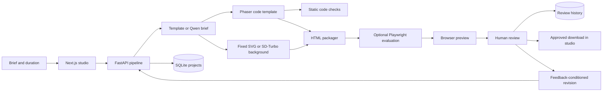
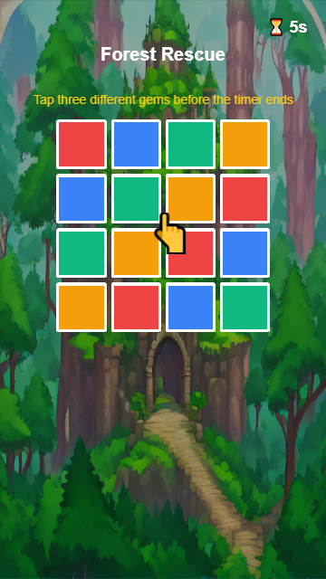

# PlayForge AI

**A local studio for building, previewing and reviewing HTML5 playable ad prototypes.**

PlayForge turns a brief into a template-based tap puzzle, packages it as an offline HTML file, and records a human review before enabling download in the studio. It brings Python pipeline development, interactive creative output and review tooling together in one inspectable project.

The current version offers two modes: a fast deterministic template and a local AI pipeline using **Qwen2.5-0.5B-Instruct** for a validated creative brief and **SD-Turbo** for a diffusion-generated background. The Phaser mechanic remains a code template. No paid API is called.

Model output is not accepted blindly: the brief is validated with Pydantic, visible text is escaped before entering JavaScript, and an optional Playwright evaluator runs the actual HTML offline. Reviewer feedback can generate a linked new version that requires a fresh approval.


## What you can try

1. Enter a brief and choose a duration between 5 and 60 seconds.
2. Generate and play a tap puzzle in the browser.
3. Inspect the static code checks and measured pipeline duration.
4. Approve the output or request changes with written feedback.
5. Download the approved HTML and open it without internet access.
6. Restore a saved project by ID to inspect its review history.

The implemented mechanic requires three different tile taps to win. Repeated taps on the same tile do not earn extra points. Letting the timer expire produces a failure screen.

## Engineering focus

| Area | Implemented evidence |
| --- | --- |
| Python creative pipeline | FastAPI endpoint, Pydantic request/response models and separate design, code, asset and validation stages |
| Playable creative output | Phaser scene template, touch interaction, timer, win/fail screens and demo CTA |
| Evaluation | Explicit static checks for scene structure, touch handlers, win logic, timeout and CTA; separate browser regression checks |
| Human-in-the-loop review | Persistent approve/request-changes decisions with feedback and timestamps |
| Reproducibility | Local setup, backend tests and a versioned Phaser engine bundled into exported HTML |

This project focuses on tooling around creative production: inspectable outputs, explicit failure states and recorded human decisions. It is a portfolio prototype, with the boundary between implemented and proposed features documented below.

## Architecture



The design stage can call a local LLM; the image stage can call a local diffusion model. The coordinator is a fixed Python pipeline, rather than autonomous tool selection. LLM function calling is not implemented. The optimization stage returns no performance claims or simulated improvements.

## Stack

Python, FastAPI, Pydantic, SQLite, Transformers, Diffusers, PyTorch, Playwright, Next.js, React, TypeScript, Tailwind CSS and Phaser 3.80.1.

## Run locally

Prerequisites: Python 3.11+ and Node.js 18.17+.

```powershell
git clone https://github.com/themaden/PlayForge-AI.git
cd PlayForge-AI
python -m venv .venv
.venv\Scripts\python.exe -m pip install -r backend/requirements.txt
npm ci
```

Start the backend:

```powershell
.venv\Scripts\python.exe -m uvicorn backend.main:app --host 127.0.0.1 --port 8000
```

In another terminal, start the studio:

```powershell
npm run dev -- --hostname 127.0.0.1
```

Open [the studio](http://127.0.0.1:3000) or [the API documentation](http://127.0.0.1:8000/docs). Project data is stored in `backend/data/projects.sqlite3`; set `PLAYFORGE_DB` to use another path. `NEXT_PUBLIC_API_URL` overrides the studio's backend address.

## Optional local AI setup

The basic template does not download any model. For Local AI mode, install the extra dependencies:

```powershell
.venv\Scripts\python.exe -m pip install torch --index-url https://download.pytorch.org/whl/cpu
.venv\Scripts\python.exe -m pip install -r backend/requirements-local-ai.txt
```

The default evaluator uses Microsoft Edge on Windows. For bundled Chromium, run `python -m playwright install chromium` and set `PLAYFORGE_BROWSER_CHANNEL=chromium`. First model use downloads several GB to `.models/`, which is excluded from Git. CPU inference may take minutes. This implementation was tested using CPU inference on a 32 GB RAM machine.

Choose **Local AI**, enable a diffusion background, and enable browser checks. Request changes with feedback, then select **Generate revision**. Each revision stores its parent ID and starts with pending review.

The browser checks execute taps, repeated taps, win, demo CTA and actual timer expiry; they also check that the generated background texture loaded. Screenshots are saved under `backend/data/evaluation/`. Failed runtime checks prevent approval.

## Verification

```powershell
.venv\Scripts\python.exe -m pytest backend/tests -q
npm run build
```

Thirteen backend tests passed for the current implementation. The frontend production build passed. Browser checks verified canvas loading, repeated-tap behavior, winning, timer expiry, review persistence, approved download and offline HTML execution.

Pipeline duration is measured with `time.perf_counter`; it includes model loading, inference, packaging and optional browser evaluation. It excludes database writes and frontend network transfer. FPS, time to first action, engagement and CTR uplift remain unmeasured and are not presented as results.

## Current boundaries

- One tap puzzle template is implemented. Full match-3, pull-the-pin and tile blast are not implemented; unsupported requests return an error.
- Template mode uses fixed rules; Local AI mode uses an LLM-generated brief. Function calling, RAG and vector databases are not integrated yet.
- SVG examples remain fixed. Local AI mode can generate a diffusion background and load it into the game. Video generation is not integrated.
- Static checks inspect code. Optional browser evaluation runs for each output; checks cover this known template rather than arbitrary generated games.
- Reviewer feedback is added to the brief to generate a linked revision. Small-model instruction following is imperfect; review each new output.
- Approval gates the studio download button. The API is a local prototype without authentication or an enforced export permission boundary.
- The CTA displays a demo message. Export is not certified for Meta, TikTok, Google or Unity ad networks.

## Roadmap

- [ ] Structured brief fields that change visible game output.
- [x] Local LLM integration with validated structured output and provider provenance.
- [x] Real diffusion background generation loaded into the playable scene.
- [x] Optional browser evaluation with captured errors and screenshots.
- [x] Revision history linking reviewer feedback to a new output.
- [ ] Retrieval of licensed creative references using embeddings and a vector database.

## License

MIT. Phaser is redistributed with its [MIT license](backend/vendor/PHASER_LICENSE.md).

## Model references and licenses

- [Qwen2.5-0.5B-Instruct](https://huggingface.co/Qwen/Qwen2.5-0.5B-Instruct): Apache 2.0 model weights.
- [SD-Turbo](https://huggingface.co/stabilityai/sd-turbo): model weights have a separate Stability AI license; review that license before commercial use.

The repository's MIT license covers its code, not third-party model weights. This is a portfolio demo, not an ad-network-certified product.

## Reproduce the verified AI demo

```powershell
.venv\Scripts\python.exe scripts/verify_local_ai.py
.venv\Scripts\python.exe scripts/verify_revision.py
```

These scripts run real model inference, create a diffusion background, execute the exported HTML in an offline browser, record reviewer feedback and produce a linked revision. They require the optional local AI dependencies.

- [Original playable HTML](docs/examples/forest_playable.html)
- [Revised playable HTML](docs/examples/forest_revision.html)
- [Original verification record](docs/examples/verification.json)
- [Revision verification record](docs/examples/revision_verification.json)

Download HTML files to open them in a browser. The records describe example runs, not advertising campaign performance. Generated titles, CTA and image prompts come from Qwen; the gameplay instruction is fixed to the implemented mechanic to prevent unsupported instructions. Image prompts are not always obeyed precisely, so visual review remains necessary.


